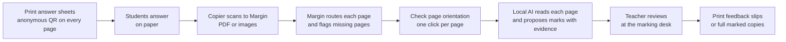
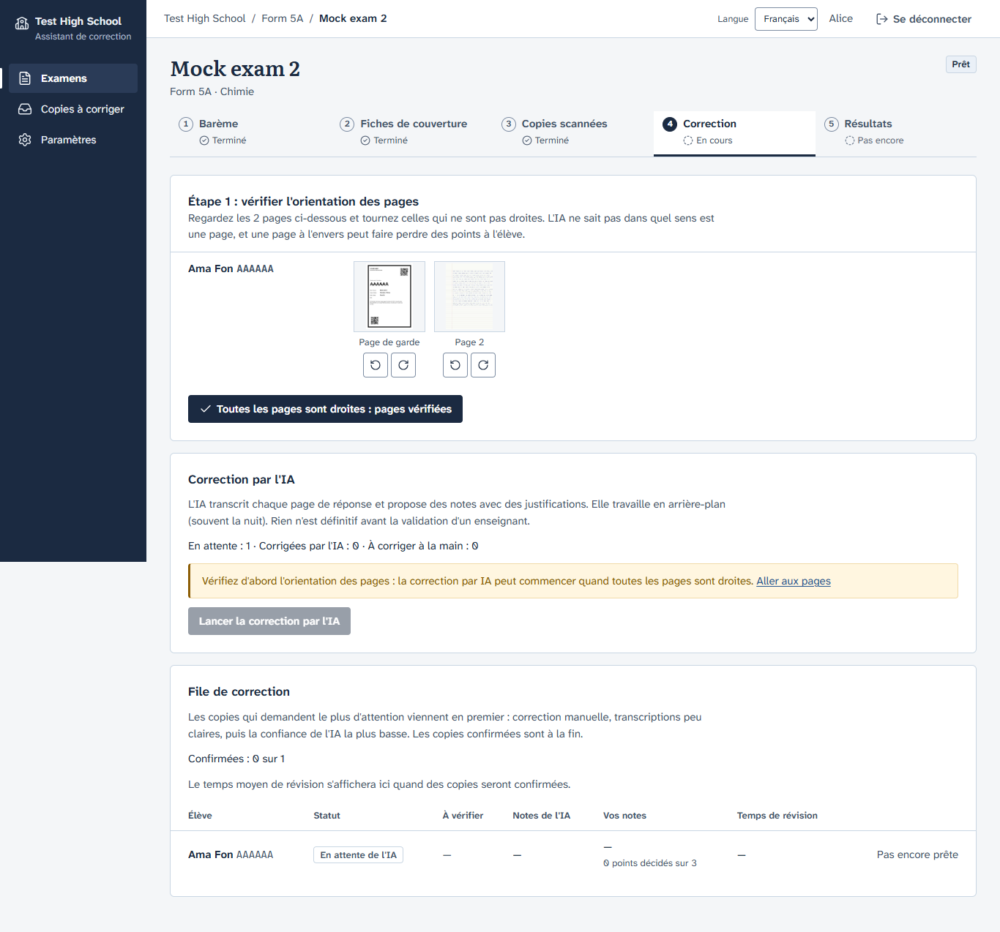

<div align="center">

# Margin

### The AI marking assistant that never lets student data leave the school

**Margin reads handwritten exam scripts, proposes marks against the teacher's own mark scheme,
and shows exactly why. Then the teacher decides.** It runs on a single school computer with an
open AI model, offline, in English and French.

`On-premise` · `Offline` · `Open models only` · `Teacher-confirmed` · `English | Français`


<sub>The marking desk, showing synthetic test data.</sub>

</div>

---

## Why Margin

A secondary-school teacher with five classes can face 200 scripts after a single exam: weekends
of marking, and feedback that reaches students weeks later. AI could help, but the obvious tools
send children's handwriting to a cloud company, and they mark on their own.

Margin takes the other road:

- **The data stays in the building.** Scans, transcriptions and marks live on one school
  computer. The AI model runs on that same computer. Nothing is sent to a third-party AI service:
  network calls are restricted to the school's configured model server and private-IP
  printer. Tests guard these boundaries.
- **QR codes contain no personal data.** Cover sheets carry a random QR token and a
  pseudonymous student code. Names stay local; feedback slips can show the student
  name, and names are not sent to the grading model.
- **The AI proposes; the teacher decides.** No mark is final, and nothing is exported, until a
  teacher confirms it. Every change is in an append-only audit log, and every AI output records
  its model, model version and prompt version.

## Windows school workflow

**Windows is the school installation target.** See [Windows scanner and printer setup](docs/WINDOWS_SCHOOL_SETUP.md) for the copier share, IPP printer, test scan and test page. Automatic inbox intake and direct printing implement the first part of the [end-to-end audit](docs/BLUEPRINT_AUDIT.md). The student portal and home access remain planned; do not expose the current staff application publicly.

## How it works



1. **Set up the exam:** type the mark scheme or import it as CSV. It reads like a printed one.
2. **Print answer sheets.** Each page has an anonymous QR; spare sheets and A4 labels are available.
3. **Scan to Margin** from the copier. Margin archives and routes the pages automatically.
   Anything it is not sure about goes to a tray with a plain reason, never a guess.
4. **AI marking runs in the background**, often overnight: a progress bar, an estimated time
   left, and the page being read right now.
5. **Review at the marking desk.** For each mark scheme point the AI gives a proposed mark, its
   evidence lines in the student's answer, a category ("conceptual error", "language /
   expression"…) and its confidence. The scripts that most need attention come first.
6. **Confirm and print.** Return original papers with a one-page feedback slip, or choose a
   full marked reprint. Print one student, a selection, all confirmed or not yet printed.
   The queue distinguishes sent, printed, failed and uncertain jobs. PDF download remains available.

## The marking desk

The screen where teachers spend their time is built for speed:

| Key | Action |
|---|---|
| `J` / `K` | Next / previous script |
| `←` / `→` | Previous / next question |
| `↑` / `↓` | Previous / next mark scheme point |
| `0`–`9` | Give that many marks |
| `A` · `Shift+A` | Accept the AI's proposal · accept all remaining |
| `E` | Show the evidence on the page |
| `Enter` | Confirm marks |

- The scanned page sits on the left, with an exercise-book margin line and the evidence for the
  selected point highlighted across the page.
- The checklist sits on the right: one question at a time, every point with its evidence line
  numbers.
- Confirming a script is the one animated moment: the total settles in green, like a stamp.

<table>
<tr>
<td width="50%"><br><sub><b>What needs you today:</b> real counts, in the order of the work.</sub></td>
<td width="50%"><br><sub><b>Check page orientation</b>, fully in French.</sub></td>
</tr>
</table>

## What teachers get

- **Results that point to teaching.** A class table sorted any way you like, with each
  question's class average and the share of students who scored zero. Topics worth reteaching
  stand out.
- **Exports:** a results CSV, marked PDFs per student or one print-ready file for the class, and
  (with consent) a training-data export so the school's own model can learn from its teachers'
  corrections.
- **Notation printed properly:** CH₄, x², Na⁺ and → appear correctly in printed comments.
- **Showing the mark scheme to students is optional**, per exam: "Missing: …" notes on their
  copy, or only the teacher's own comments.

## Built to be trusted

| | |
|---|---|
| **Validated AI output** | Every model reply is checked against a strict, per-question schema. Invalid output is retried once, then the script is flagged for marking by hand. Margin never drops data and never invents a mark. |
| **Honest about test output** | Output from the built-in test model is labelled "Test model: not real AI marking" everywhere it appears, and production refuses to start with it configured. |
| **Resilient** | Long work runs in a background worker on a database job table. Jobs survive restarts, and the web app keeps working when the AI is busy or offline. |
| **Secure** | Argon2 passwords, httpOnly secure session cookies, CSRF protection, administrator and teacher roles, and teachers see only their own classes. PDFs are processed in a separate, time-limited process. |
| **Accessible** | WCAG AA contrast checked by a test on every colour pair, full keyboard use, visible focus everywhere, and colour never the only signal. |
| **Bilingual** | Every string is in English and French, and a test keeps the two in step. |
| **Permissive licences only** | No GPL/AGPL dependencies. Every package, font and icon is recorded with its licence ([`THIRD_PARTY_NOTICES.md`](THIRD_PARTY_NOTICES.md)). |

**Measured, not assumed.** Every change to the prompt or model is evaluated per subject: exact
agreement, agreement within one mark, mean absolute difference, and over- versus under-marking.
On the current synthetic evaluation set the default model (`qwen3-vl:4b-instruct`) matched the
reference mark exactly on 81 % of questions, with a mean absolute difference of 0.25 marks. Real
handwritten scripts are the next benchmark.

## Get started

**On a school computer, without Docker** (works on ordinary Windows laptops):

```bash
git clone https://github.com/Ngum12/Margin.git && cd Margin
uv python install 3.12
cd backend && uv sync --frozen && cd ..
cd frontend && npm ci && npm run build && cd ..
ollama pull qwen3-vl:4b-instruct
python scripts/run.py        # http://127.0.0.1:8000
```

**With Docker:**

```bash
cp deploy/compose.env.example .env.docker   # set MARGIN_SITE to this computer's address
docker compose up -d --build
docker compose exec ollama ollama pull qwen3-vl:4b-instruct
```

HTTPS on the school network comes from Caddy, with its own local certificate. Backups are one
command: `python -m app.cli backup`. A demo class is one more: `python -m app.cli seed-demo`.

**[Read the full installation guide](docs/INSTALL.md)**: first start, HTTPS and certificates,
backups, updates and troubleshooting.

## Under the hood

```
Browser (React + TypeScript) ──HTTPS──> Caddy ──> FastAPI app ──> SQLite (WAL) + local file store
                                                       │
                                            Worker (job table) ──> Ollama (local vision model)
```

- **Backend:** Python 3.12, FastAPI, SQLAlchemy 2, Alembic, pypdfium2 (rendered in a child
  process), ReportLab for the marked PDFs, and Pillow for the red-pen layout.
- **Frontend:** React 19 and TypeScript (strict), plain CSS from design tokens, and bundled fonts
  (Literata, Atkinson Hyperlegible Next, Caveat). No CDN of any kind.
- **AI:** the models sit behind `Reader` and `Marker` interfaces, with versioned prompts.
  Swapping the model is a setting, followed by an evaluation.
- **Quality:** about 650 automated tests (pytest, Vitest, Playwright in Edge), strict mypy, ruff
  and ESLint. One command runs everything: `python scripts/check.py`.

## Documentation

| | |
|---|---|
| [Installation](docs/INSTALL.md) | School computer, Docker, HTTPS, backups |
| [Design system](docs/DESIGN.md) | The "Marking desk" visual language, tokens and contrast ratios |
| [Decisions](docs/DECISIONS.md) | Every design and product decision, with its reasons |
| [Plan](docs/PLAN.md) | Phases and what comes next |
| [Dependencies](docs/DEPENDENCIES.md) | Every dependency, its version and licence |

## Status

Margin is in active development toward its first school pilot. Phases 0–5 are complete: accounts
and classes, mark schemes, scanning and splitting, AI marking, teacher review, results and
exports. Phase 6 (deployment, backup and the demo) is in progress. Next comes fine-tuning on
teachers' corrections, so each school's model learns from its own teachers.

<div align="center">

**Margin: the AI does the reading; the teacher keeps the pen.**

</div>
