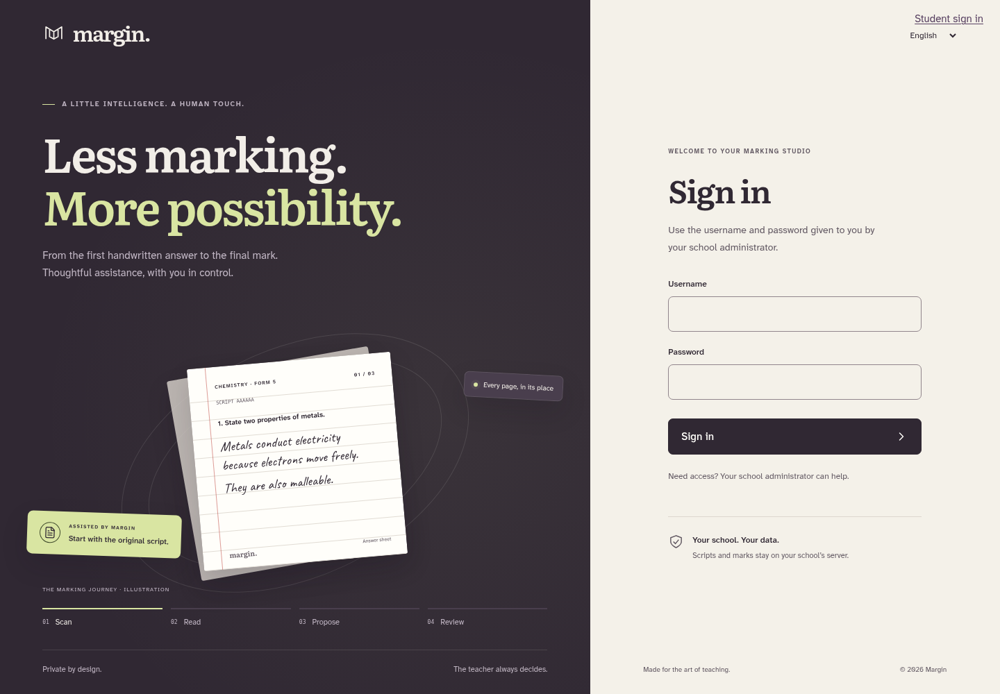
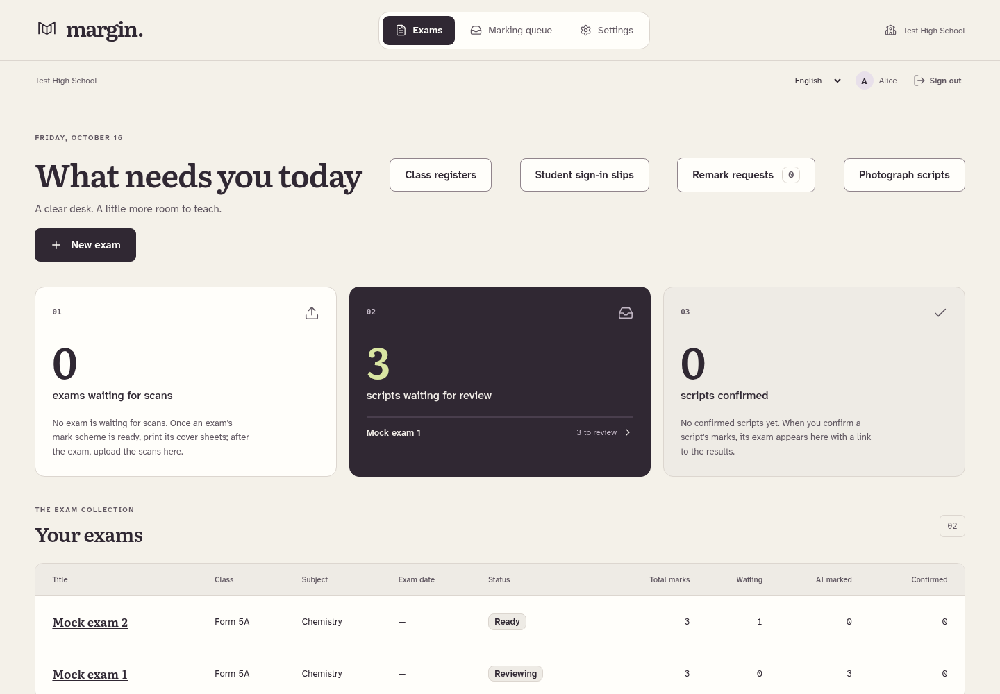
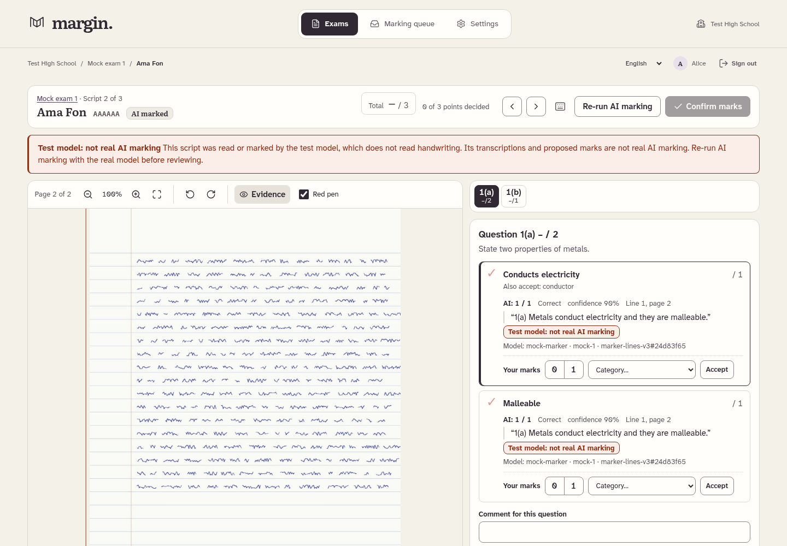
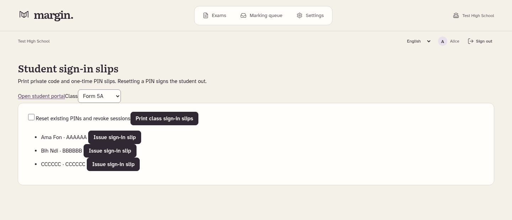

<div align="center">

# Margin

### From handwritten answers to teacher-confirmed results.

A local marking workspace for schools.
Scan the scripts. Review the evidence. Return the feedback.

**School-local AI & storage · Teacher-confirmed marks · English & French**

[Get started](#get-started-on-windows) · [See the workspace](#inside-margin) · [School installation](docs/WINDOWS_SCHOOL_SETUP.md) · [Documentation](#documentation)

</div>



## Built around the school day

Margin connects the photocopier, the marking desk and the school printer. A local
model reads handwritten answers and proposes marks against a confirmed scheme.
Teachers review the evidence and approve every final mark before returning work.

After an exam, the default workflow needs **no file uploads or downloads**:

| 01 · Scan | 02 · Review | 03 · Return |
| :--- | :--- | :--- |
| Press **Margin** on the photocopier. Page QR codes route the pile to the right exams and students. | Start with the least-confident scripts. Compare the scan, evidence and scheme; confirm the marks. | Press **Print** for feedback slips in register order. Release results separately to students. |

Phone capture, manual uploads and PDF downloads are available when school hardware
is unavailable. Original scripts remain the source of truth.

## Inside Margin

### A workspace that shows what needs attention

Scan arrivals, review work and remark requests sit alongside the class registers
and exam list, so teachers can move directly to the next task.



### The answer and the reasoning, side by side

The marking desk keeps the original page beside the mark-scheme checklist.
Evidence, proposed marks and teacher decisions stay visible together, with keyboard
shortcuts for review. Diagrams and other teacher-only items require a human mark.



### A private way to return results

Teachers issue student codes and one-time PINs from **Student sign-in slips**.
Students choose their own PIN at first sign-in and see only their released work:
original pages, marks, permitted feedback and progress. Question-level remark
requests keep the discussion attached to the answer.

<details>
<summary><strong>See the student sign-in slip controls</strong></summary>



</details>

*These are captures of the running application with fictional school data and mock
AI. Mock-model notices are intentionally visible; the screenshots demonstrate the
workflow, not handwriting-recognition accuracy. The sign-in animation is an
illustration of marking, not live processing.*

## What schools can do

| Area | Included |
| :--- | :--- |
| **Class registers** | Confirmed XLSX, CSV, pasted-text and local photo/PDF imports; persistent student records, register order and history. |
| **Mark schemes** | Local PDF, DOCX, image, text and CSV imports; editable drafts; school library; alternatives, rejects, any-N groups, M/A dependencies and ecf. |
| **Paper workflow** | Per-page QR answer sheets, spares, cover sheets and A4 labels; watched scan inbox, mixed-exam routing and an attention list. |
| **Marking & review** | Automatic eligible-script marking, restart checkpoints, confidence ordering, teacher-only items and audited confirmation/reopening. |
| **Returning work** | Direct IPP printing, feedback slips or full marked reprints, class/selected/unprinted batches and a durable print queue. |
| **Results & students** | Question averages, zero-score shares, Excel export, release controls, private student access, remarks and optional department-head escalation. |

## Your school keeps control

- **Local by design.** The database, scripts and AI model stay on the school box.
  Fonts and assets are bundled; there is no external AI service or telemetry.
- **Teachers decide.** A model proposal is never a final mark. Confirming marks
  and releasing results are separate actions.
- **Access is scoped.** Administrators, department heads, teachers and students
  have server-enforced permissions. Students see their own released records.
- **Recovery is planned.** Persistent jobs resume after interruption. Local
  backups include database snapshots and checksummed files; restore validates
  the archive before replacing data and keeps the previous directory.
- **Learning is opt-in.** Training exports require school and individual consent.
  They contain aggregate correction statistics, suppress small groups, and exclude
  handwriting, names, identifiers and free text. Nothing is sent automatically.

Optional **student access from home** serves the signed-in student's released work
over HTTPS from the school box. It needs school internet, DNS and a reachable public
address. Staff screens, the model, SMB and printer ports remain private.
[Configure home access →](docs/WINDOWS_SCHOOL_SETUP.md#optional-student-access-from-home)

## Get started on Windows

**Prerequisites:** Git, Python 3.12, uv and Node.js/npm. Start with a dedicated
Windows account, a local SSD and approximately 16 GB RAM. Real marking also needs
Ollama and the local model; GPU capacity affects marking speed.

Open PowerShell and prepare the application:

```powershell
git clone https://github.com/Ngum12/Margin.git
Set-Location Margin
Copy-Item .env.example .env
$env:UV_PYTHON_PREFERENCE = "only-managed"
uv python install 3.12
Set-Location backend
uv sync --frozen
Set-Location ..\frontend
npm ci
npm run build
Set-Location ..
```

For a local demonstration, set `MARGIN_ENV=development` and
`MARGIN_AI_BACKEND=mock` in `.env`. Then create the school and administrator:

```powershell
Set-Location backend
uv run python -m app.cli migrate
uv run python -m app.cli init-school --name "Your School" --country Cameroon
uv run python -m app.cli create-user --username admin --display-name "Administrator" --role admin
Set-Location ..
python scripts/run.py
```

Passwords are prompted privately. Keep the launcher running: it starts both the
web app and worker. For this local demo, open `http://127.0.0.1:8000` on the same
computer. Run one launcher per school database.

**Next:** follow the [Windows quick start](docs/WINDOWS_QUICKSTART.md) to configure
real local AI, HTTPS, the copier and printer, student access and nightly backups.
Production uses `MARGIN_ENV=production` and `MARGIN_AI_BACKEND=ollama`; secure
HTTPS setup is required before school-network sign-in.

<details>
<summary><strong>Try the three-subject demonstration</strong></summary>

With the school created and mock mode selected, run once from `backend`:

```powershell
uv run python -m app.cli seed-demo
```

Choose a password for the `demo` teacher. Margin creates six fictional students
and ready Chemistry, Mathematics and Economics exams. Mock output is labelled
and does not measure real marking accuracy.

</details>

<details>
<summary><strong>Update an existing installation</strong></summary>

Back up first, stop the launcher and worker, then run from the repository root:

```powershell
git pull origin main
Set-Location backend
uv sync --frozen
Set-Location ..\frontend
npm ci
Set-Location ..
python scripts/run.py --rebuild
```

Refresh the browser with **Ctrl+Shift+R**. Rebuilding matters: pulling source alone
does not replace the frontend already being served. Startup applies migrations.

</details>

## Documentation

| Guide | What you will find |
| :--- | :--- |
| [Windows quick start](docs/WINDOWS_QUICKSTART.md) | Installation commands, teacher workflow, student access and backup essentials. |
| [School hardware & home access](docs/WINDOWS_SCHOOL_SETUP.md) | Native Windows SMB, copier setup, IPP printing and optional public student HTTPS. |
| [Installation & recovery](docs/INSTALL.md) | HTTPS, Docker alternative, startup, upgrades and a restore checklist. |
| [Blueprint implementation audit](docs/BLUEPRINT_AUDIT.md) | Delivered stages, format limitations and school acceptance checks. |
| [Architecture & development rules](CLAUDE.md) | Application structure, permissions, review rules and engineering conventions. |
| [Technical decisions](docs/DECISIONS.md) | Design decisions and investigated failures. |
| [Dependencies](docs/DEPENDENCIES.md) · [Third-party notices](THIRD_PARTY_NOTICES.md) | Approved versions and dependency licences. |

## Development & verification

FastAPI · React / TypeScript · SQLite · Ollama · Windows SMB · IPP

Run the complete check suite from the repository root:

```powershell
python scripts/check.py
```

It covers Python formatting, lint, types and tests; dependency notices; frontend
formatting, lint, types, tests and production build; and real-browser workflows.
Browser checks use installed Edge; `MARGIN_BROWSER_PATH` can select another
installed Chromium browser. No real student data is needed for the tests.

**Before a school pilot:** verify copier feeding/QR legibility, Windows sharing,
printer PDF/duplex/status support, phone-camera quality and backup restore on the
school's equipment. Public home access also needs DNS/TLS/router verification.
Real handwriting accuracy has not been established by the mock test suite.

Legacy `.doc`/`.xls` files need conversion to supported formats. Embedded DOCX
images must be supplied as PDF or images for OCR. Strongly distorted or blurred
phone photos need retaking. Experimental marks-only overprinting onto originals
remains deferred.
